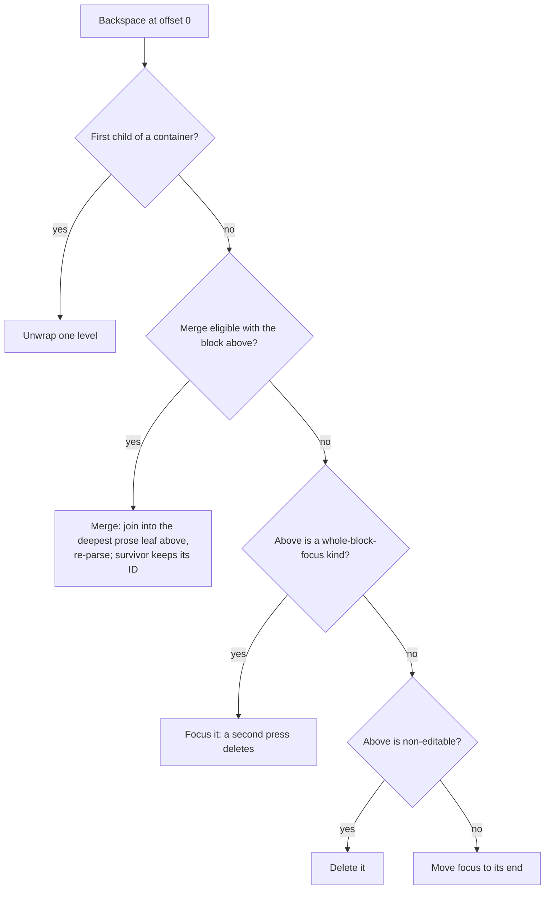

# Structural edits and containers

Every edit that changes which blocks there are, rather than the text inside one: split, merge, delete, move, a kind change, and the containers (quotes, lists, tables) that nest blocks inside blocks. It leans on the terms [`editor.md`](editor.md) sets up in its first three sections (`raw`, kind, scope, path), so prob read those first. Jump:

- [Orchestration](#orchestration): who calls whom, up and down the component tree
- [Structural operations](#structural-operations): split, merge, delete, reorder, a block changing kind, and the blank lines between blocks; then what Backspace does at a block's start, blocks you focus whole (a rule, a diagram), unwrapping a container, and the Enter or space that finishes a construct's syntax for you
- [Focus traversal](#focus-traversal): arrow keys crossing from one block to the next, and how the caret keeps its column on the way
- [Containers](#containers): indices inside a container, how a container's `raw` stays in step with its children, the markers drawn beside a block's text, and a container's title row

## Orchestration

**Upward.** Blocks call typed context functions for structural operations (the bundle in `editor.md` § Data flow, plus focus moves, undo and redo), each taking a block index relative to the **local** children array. Besides the action bundles, each under its own context key, the block-editor interface rides three named facets in `src/lib/editor-keys.ts`:

- `EditorServices`: the event channel, the view-state stores, and the cross-scope commit and reorder primitives;
- `EditorPolicies`: what the host configured;
- `EditorDoc`: document identity and the per-instance lookups that hang off it.

Every container provides its own block-editing and focus bundles (their indices are local to its children), passes container editing through from above unless it changes it, and overrides single functions inside any of the three rather than whole bundles. That's why each bundle has a key of its own. History stays its own key that only the editor root provides, so undo/redo resolve to one stack. Everything else resolves by walking up the context tree to the nearest ancestor that provides it, so a container that changes nothing writes no code to pass it along.

**Downward.** The editor reaches down through component refs (the `BlockComponent` interface in `src/lib/block-component.ts`), mostly for focus and caret reads; the rest serves selection paint, pointer hit-testing, clipboard routing, windowed descent, commands and `insertMarkdown`. After a structural mutation and `await tick()`, the caret landing (`commit-and-undo.md` § The commit primitive) calls `focus(offset)` on the target block, the range-ending verb, so a landing after a cross-block operation can't leave the old range painted.

## Structural operations

Every structural operation is a tree mutation performed by the editor shell, never by a block.

**Split.** Cut `raw` at the cursor offset and re-parse each half as the blocks it holds, normally one apiece. The original keeps its ID; every other node gets a fresh one. Offsets are raw offsets, markers included, and the block component translates DOM position to raw offset; the marker isn't duplicated, the second half re-parsing as its natural kind. Three edge rules:

- A cut landing _on_ a line ending ends the first half with it, rather than opening the second with a blank line the user never typed.
- A cut at or before an ATX heading's text moves the whole heading down, `#` and all. An empty heading left above is nothing anyone asked for.
- A structural suffix (raw past the content range: a setext underline, or an ATX heading's closing `#` run) stays with the first half, so the split can't strand it below where it reparses as something else.

A multi-block paste cuts its target with the same function (`src/lib/tree-operations/structural-suffix.ts` :: `cutKeepingStructure`), so all three hold there too.

**Enter completion.** A split that creates a construct instead of cutting one. A split puts a blank line between its halves wherever they'd otherwise read back as one block, which two prose lines always would, so a grammar needing its lines adjacent (a table's header and delimiter, say) could never be typed into existence. So before splitting, the Enter-completion registry (`editor.md` § The other registries) gets asked: where the block is a single line of prose whose every byte is content and the caret sits at its end, a registered completer may claim the line and answer the lines that complete it. A completer that sets `onType` is also asked after every typed write (a keystroke's, never a command's or a paste's), which is how block math's `$$` forms without an Enter.

```ts
// grammar: the editor's grammar, which knows which completers this editor runs
completeTypedLine('| a | b |', grammar);
// {
//   lines: ['| a | b |', '| --- | --- |', '|  |  |'],
//   caret: { path: [1, 0], line: 0, column: 0 }   // the first body cell
// }
completeTypedLine('ls | grep foo', grammar); // null: no leading pipe, nothing to complete
```

The claim becomes a block replacement in the slot (one undo entry, the paragraph coming back exactly as typed with the caret where it was) and consumes the press. A completer answers its caret as a line and a column inside the node it addresses, never a byte offset, because the editor attaches the line ending after the claim. The consult wraps the composed split action rather than sitting inside it, above any container's own split override, so a container can't take the branch out of its subtree and no press crosses it twice. The table is the built-in registrant; block math (`$$`) is the bundled plugin one.

Two grammars that look like candidates aren't. Front matter is position-blind to a completer (`tryComplete` sees a line, not where the document starts) and a typed `---` parses as a thematic break, which the prose gate excludes, so it would need a different signal. A footnote definition forms from one line, so Enter has nothing to complete, and whether `[^1]:` opens is an opener question.

**Merge.** Backspace at a block's start, Delete at its end, and a list item merging into the one above it (M1, below) are one join, `tree-operations/node-ops.ts :: joinIntoLeaf`. It writes the lower block's text onto the end of the upper one: Backspace into the upper block's deepest prose leaf (for two paragraphs, that's just the upper paragraph), Delete into the upper block itself, which then re-reads. The details:

- The lower block's text goes through its own kind's write rule first (`tree-operations/leaf-range.ts :: joinLeaves`), then through the same rules typing does, the leaf kind's own and then its container's. So a join in a `<details>` body that spells `</details>` out of two halves lands escaped.
- Then the leaf re-parses, and its kind follows its bytes: two backticks joined to a backtick and some text become a code fence.
- A join whose bytes reparse as more than one block is refused at the write, and the caret moves across the boundary instead.
- The survivor keeps its ID, and the caret lands at the join, following the joined bytes if the fix-up merges the survivor further up.
- The second block's text lands at the first one's content end, so a structural suffix (a setext underline, an ATX heading's closing `#` run) stays past the joined text.
- The joined text ends the way the lower block did, so a file with no final line break still has none.

**Delete.** Remove the node from its children array, then fix up the join that removal opened (Settling a disturbed join, below), so the blocks on either side keep their kinds, same as the pair a move leaves behind. The caller says what removed the block (Backspace, Delete, a cut, or `'keyless'` for a delete no key asked for, like the block menu's), and the caret lands once, on the side that points (`src/lib/selection/caret-target.ts` :: `survivorAfterRemoval`). Backspace and a keyless delete go to the end of the block above, or the start of the one below when there's nothing above. Delete and cut go the other way round. A range made only of whole blocks lands by the same rule, and the caller doesn't place a caret of its own afterwards.

The document always keeps a block. A delete that takes the last one (a lone rule, say) leaves an empty paragraph with the caret in it, and the commit adds that paragraph itself (`commit-and-undo.md` § The commit primitive, step 7), so one undo brings the block back. A container doesn't get to sit there empty either: a delete that takes its last child takes the container too, and its parent if that empties next, all the way up (`src/lib/tree-operations/cleanup.ts` :: `cascadeCleanupEmptyAncestors` for a range, `src/lib/editor-actions/nested/emptied-container.ts` :: `removeEmptiedContainer` for a container's only child). One exception: a range that starts in text inside a container and runs on past it keeps the spot it started in, so select from `> a` through the paragraph below, delete, and you're left with `>` holding an empty paragraph.

**Reorder.** Move a node among its siblings. The moved block keeps its ID, and both edges of the moved window are checked:

- a block that lands flush against a neighbour it would be read into (a table under a paragraph, a rule under one) arrives with its separator;
- the two blocks it left behind keep a blank line between them if either had one against the moved block and they'd otherwise reload as something else. If both were flush against it, they rejoin the way prose would (text running on into the paragraph or quote above, two quotes becoming one). That can merge a block into its neighbour, so the caret goes where the commit says it landed. A rejoin that would change a block's kind (a table read as paragraph text, a rule read as a setext underline) gets the blank line instead;
- a document with no final line break still has none after a move, same as after any structural edit (`commit-and-undo.md` § The commit primitive).

Two gestures, one operation: keyboard (Alt+↑/↓ on the focused block, with a screen-reader announcement) and a pointer drag from the block's handle, revealed on hover and shown outright where nothing hovers (an insertion line marks the drop, one commit on release, autoscroll for off-screen targets). Keyboard reorder is always available. The handle is on by default outside reading mode (`blockDragHandles`) and belongs to object blocks alone (code, tables, equations, diagrams, pictures, list items, dividers, cards), never prose, whose grips would be noise beside every line (`pageRole`, `editor.md` § The block-kind descriptor). A table's one handle moves the whole table; the right-click cell menu carries the row and column actions.

**Kind change.** When a re-parse of a block's updated `raw` yields a different kind, the node is replaced with one of the correct kind and keeps its ID; when it yields several blocks, the first keeps the slot's ID and leading trivia and the rest splice in with fresh IDs, exactly as a split does. The same rule runs a level up for **containers**: an edit inside one changes what the container's own rebuilt `raw` parses to (typing the rest of a `> [!TIP]` marker), so the ancestry rebuild re-derives the container's kind and swaps the slot the same way (§ The container `raw` contract). A demotion also fixes up the joins it disturbed.

**A disturbed join.** After every edit a fix-up re-derives the blank lines around it, since a mutation can break an adjacency that was fine before it. When two neighbours' bytes re-read as **fewer** blocks, or as the same count with the upper block holding content from the lower, that's the reload's own reading, so the tree takes it rather than inventing separator bytes in an untouched neighbour. Everything that disturbs a join has to ask it that question, through the commit's one fix-up (`tree-operations/fix-up/apply.ts` :: `fixUpEdit`, `commit-and-undo.md` § The commit primitive), or the part of it a write or a splice below the commit's scope runs as it lands (`updateNodeContent`, `spliceFixedUp`); the one join no scope-local ask can see, a container's own slot in its grandparent's array, is asked on the way out of the ancestry rebuild (§ The container `raw` contract). Which caller asks through which entry is `docs/contributing/codebase-map.md` § Blank lines and separators. Before any merge, the fix-up asks each join a delete or a move left whether a blank line belongs there, by reading the two blocks flush and with a blank line between (`tree-operations/fix-up/joins.ts` :: `partJoin`). A block the move placed stays apart from whatever it would be read into, and a pair the edit uncovered only rejoins the way prose would.

A write that keeps its block's kind still asks the join below it whenever there's a block down there, blank line or not. An HTML comment, `<pre>`, `<?` or `<![CDATA[` block reads on until its closer, blank lines included, so breaking `-->` with one Backspace makes the comment swallow the paragraph two lines down. The join above is asked only when:

- the block sits right under its neighbour, since a flush pair can re-read without either kind changing (retype a `<div>` under a paragraph as `<span>` and the two read as one paragraph);
- the write changes the first line's indent, which alone decides whether a list item above takes the block in;
- a blank line stays blank.

So the only keystroke that asks nothing is one in the last block of its container (or the document) with nothing flush above it. The ask reads the block above a join whole and the block below one line deep when it can (`performance.md` § 4 has the rule and what it costs).

One construct isn't beside the write at all. A lone `$$` that never found its closing `$$` reads as a paragraph, and the `$$` that closes it can turn up several blocks further down. Each opener that backs out like that says which lines could finish it (`readingNotFinal.mayClose`). A write whose changed lines include one of those walks up to the topmost block that's still waiting, and rereads everything from there down through the write, the way a reload would (`tree-operations/fix-up/unfinished.ts`). A write that leaves its own block waiting reads downward the same way (one it typed on a line of its own already got its own closer, if a line below would close it), and doesn't stop at a line that turns out not to finish it (a `:::` under a `::::note`): it keeps going until nothing it reread is left waiting. A fence is the opposite case. Left open, it never backs out. It takes in every line below it, so it's never waiting above a write, and a typed ` ``` ` walks nowhere. A write that leaves one open reads down to the first line that could close it, or to the end of the body when nothing does, in one reread (`fenceReading`, with `readsOn` set). A keystroke whose lines couldn't finish anything walks nowhere.

A write that leaves its own construct open is closed first (`editor.md` § Reading the DOM back).

### Merge eligibility: roles, not pairs

Eligibility derives from a per-kind **merge role**, so adding a kind doesn't mean editing an enumerated pair set:

| Role             | Meaning                                                 | Kinds                                                                                                   |
| ---------------- | ------------------------------------------------------- | ------------------------------------------------------------------------------------------------------- |
| `prose`          | Leaf text block                                         | paragraph                                                                                               |
| `prose-absorber` | Prose leaf that keeps its own kind when absorbing prose | heading, setextHeading                                                                                  |
| `container`      | Merge target is its deepest reachable prose leaf        | blockquote, list, listItem                                                                              |
| `self-merge`     | Merges only with another block of the same role         | unrecognized                                                                                            |
| `not-mergeable`  | Backspace deletes (if non-editable) or moves focus      | fencedCode, indentedCode, htmlBlock, linkReferenceDefinition, table, tableRow, tableCell, thematicBreak |

`prose + prose`, `prose-absorber + prose`, `container + prose`, and `self-merge + self-merge` are eligible; every other pairing isn't. Read each pair as "the block above, then the block Backspace was pressed in":

````ts
isMergeEligible('heading', 'paragraph'); // true: the heading absorbs the paragraph
isMergeEligible('paragraph', 'heading'); // false: a heading never merges upward
isMergeEligible('blockquote', 'paragraph'); // true: into the quote's deepest prose leaf
isMergeEligible('table', 'paragraph'); // false

findMergeTarget(parse('> a\n>\n> b\n').children[0]);
// { target: { kind: 'paragraph', raw: 'b\n', ... }, path: [1] }
findMergeTarget(parse('> ```\n> x\n> ```\n').children[0]); // null: the deepest leaf isn't mergeable
````

A `container + prose` merge walks into the container's subtree for the deepest prose leaf, which is "merge into the deepest visible text above" generalized across container boundaries. When the walk finds none (the deepest leaf is not-mergeable, or the container is empty), the caller falls back to the ineligible behavior and moves focus to the end of the deepest reachable block. A whole-block-focus kind takes precedence over the `not-mergeable` row: `thematicBreak` is focused first and deleted only on the second press.

### Backspace at the start of a block



Two refinements the diagram elides: a container that declares no unwrap strategy delegates upward, the same decision re-running one level out with the container itself as the block (that's how a list item's children reach the list); and a container may override the _middle_-child branch too, a list routing its non-first items through the same cascade as its first, which is where M1 below comes from.

### Whole-block focus

A **whole-block-focus** kind (`blockFocus: 'whole-block'` in its descriptor, as in the thematic break registration in `editor.md` § The block-kind descriptor) is an opaque, childless block that is its own focus target; the built-in thematic break and the bundled mermaid diagram are the two shipped examples. One declaration buys the whole behavior set:

- arrows land on it with a whole-block highlight;
- a caret-adjacent Backspace **focuses** it rather than deleting outright, so the highlight is press one of two (Delete at the end of the block above is the forward twin);
- Enter inserts a paragraph below, and a typed character does the same, carrying the character into it;
- Backspace or Delete while focused deletes it, and the caret goes the way the key points (the Delete paragraph in § Structural operations);
- Mod+C / Mod+X copy or cut its Markdown;
- a cross-block range carries it whole;
- Alt+Arrow reorders it.

The container factory wires all of this from the one declaration, which is why mermaid is the reference a plugin author copies; the thematic break is a plain component that reaches the same tail directly. Such kinds are childless by design, and that doesn't count as empty. Every other container must hold a child (`src/lib/schema/block-kind-descriptor.ts` :: `mustHoldChild`), and one that has none gets one of two treatments. A container a parse or a write builds empty (a `>` on its own line, say) gets an empty paragraph, so the caret has somewhere to land; one a delete empties is removed (Delete, above). A whole-block kind gets neither: a phantom child would permanently violate its opaque `raw`-to-children faithfulness (§ The container `raw` contract).

DOM focus doesn't sit on the declared surface. The kind declares which element **stands for** the block, and the editor mounts a hidden editing host in the block's box and focuses that instead, because AltGr productions and IME composition reach an editing host or nowhere, and a `tabindex=0` div isn't one (the gap caret uses the same trick, `docs/design/selection.md` § The gap caret). The declared surface keeps focus only when it's itself editable, owning its caret already; otherwise the host is the block's one tab stop, and the editor demotes the declared surface out of the tab order on every read rather than once at mount, since a render swap can hand it a fresh element. What that costs an author (containment assertions, a positioned box) is `docs/guide/plugin-guide/render-primary.md` § Whole-block focus.

### Container unwrap

Backspace at offset 0 of a container's **first** child unwraps one structural level. Each press does exactly one thing, and there's no auto-merge with the block above the container. Dispatch is declaration-driven: each container's `unwrapRole` selects its first-child and middle-child strategies (`firstChildBackspace: 'lift-first-child-drop-opener'` on the blockquote, `'list-item-cascade'` for both on a list), and an undeclared container delegates upward. A container reserving child 0 as chrome (its `reservedChrome` title row) declares only the middle strategy, and the editor fills in `'keep-reserved-chrome'`, the one strategy that leaves the tree alone. The cases, named for the e2e requirements that pin them (`src/lib/e2e/requirements/blocks/list/backspace/` and `container-editing/`):

- **U2, container.** The first child is lifted out into the parent at the container's position. A quote-shaped container's opener line goes with the lift, so the remainder reparses as a plain quote (`'-drop-opener'`); one whose `rebuildRaw` re-emits its syntax keeps its own kind around the rest (`'-keep-container'`). Both are one lift, `src/lib/tree-operations/container-lift.ts` :: `liftFirstChild`. An emptied container is deleted.
- **U1, list, non-empty first item.** The item's children come out in the order they read. Its first paragraph becomes a plain paragraph before the list. A matching-type sublist gives its items to the parent level: they join the rest of the list when nothing else in the item follows them, and stay a list of their own when something does. Anything else becomes a block of its own and keeps the blank line it had above it, so two paragraphs never run together. An emptied list is deleted.
- **M1, list, non-empty non-first item.** The item's first paragraph joins the deepest visible text above it through the same join as any other merge. That's the only line the merge rewrites: the marker line goes, and every line under it keeps its bytes, so it reads wherever a reload would put it. A merge that would leave a line reading outside the list doesn't happen; the caret just moves. Ordered markers renumber. An item that doesn't open with a paragraph, or a previous item with no prose to join into, leaves the tree alone and only moves the caret.
- **Nested first item** (any list with a parent list). The item is promoted to the parent list level, the Shift+Tab equivalent. Every lift works this way (Shift+Tab, this Backspace, Enter in an empty nested item, a range's Shift+Tab): whatever came after the item inside its parent item becomes the item's own children, after any it already had, so nothing ends up reading in a new place. They all go through `tree-operations/list/item-moves.ts` :: `liftNestedItem`, and the U1 unwrap above keeps the same order.
- **An empty item** (U1 and M1 are the non-empty ones). An empty first item that has siblings, or any empty non-first item, is deleted and the list renumbers; an empty only item takes the whole list with it (`blocks/list/backspace/delete-empty.md`).

### Marker completion

An opener firing on the bare marker byte creates its container before the space that finishes the marker arrives, so that space would land in the container's child as content, a permanent leading space. A container declaring `contentStartSpace: 'complete-marker'` consumes it instead: the first space at a child's content start is taken while the marker lacks its space; a second space there is content. Where the child is empty, the press writes nothing (once text arrives the rebuild spells the marker `> ` anyway). Where text already follows the marker (`>abcdef`, the caret before the `a`), the press writes the space into the container's own line (`BlockEditActions.completeMarker`), so `>abcdef`, space, `Q` gives `> Qabcdef`. Blockquote is the shipped declarer; the list needs none, since `-` alone stays a paragraph and the flip to a list writes `- ` whole.

## Focus traversal

Arrow navigation at block boundaries uses geometry, not offsets: the cursor rect is compared against the rect of the block's first or last visual line. ArrowUp on the top visual line, or ArrowLeft at offset 0, moves to the previous block; ArrowDown on the bottom line, or ArrowRight at end of content, to the next. A plain arrow over a selection collapses it before any of these checks run. Left and Right collapse it to the end they name and stop there, while Up and Down collapse it to the end you were moving and carry on from there. `moveFocus` skips non-focusable blocks, and `focus(offset)` on a non-editable block ignores the offset. It's one traversal (`editor-actions/focus/focus-dispatch.ts :: dispatchMoveFocus`) run by the root and by every container over its own children, so a move onto a block the render window left out mounts it first at any depth, and a move to a block's end picks the outside of a hidden closer the same way everywhere. Into a container from outside, focus lands on the first (or last, by direction) editable child; out of one, the inner `BlockList` signals up to the container, which signals up to the parent list.

Reading mode has no caret, so every plain arrow is at its block's edge and steps to the neighbouring block, a table cell by the grid. ArrowDown in a block taller than the viewport scrolls a line at a time first, through the scroll owner, until the block's end shows, and an arrival shows a block's first line rather than all of it. It lives in the boundary checks themselves (`selection/shared-keydown.ts`, and `components/blocks/table/cell-keydown-plan.ts` for cells), which read a missing caret as both edges.

**Sticky column.** Cross-block caret column memory. Within a block the browser's native sticky column handles vertical movement, and the editor layers on top only at block boundaries, where the native one resets.

- **Capture.** A vertical arrow press captures the cursor's _editor-relative_ pixel X (scroll-invariant). Idempotent: the first press after a reset captures, later ones don't.
- **Reset.** Nearly any other user action: typing, click, horizontal arrows, structural ops, undo/redo, focus leaving the editor (the host's header counts as leaving), tab hidden. The carve-out is PageUp/PageDown and a bare modifier tap (Shift, Control, AltGraph, CapsLock and friends), which preserve it; `caret/sticky-column.ts` :: `classifyStickyKey` is the matrix. A block move (Alt+ArrowUp) moves no caret, so it neither captures nor resets. The column lives in the caret memory (`editor.md` § The editing surface), so a reset that isn't a key drops it along with everything else there.
- **Transparent blocks** (a block whose only content is a widget that can't be entered, the vertical stop in `editor.md` § Atomic inline widgets) are passed over without capturing or resetting; a thematic break isn't one, since arrows stop on it and focus it whole. **Participating blocks** (text, code) capture and implement `focusAtColumn(x, from)`, prose and code differing only in rendered content, same helpers, same policy.

Capture and consumption are split: the source block captures, and a separate focus dispatcher reads the value at cross-block transitions, either calling `focusAtColumn` or falling back to start/end focus (`caret-placement.md` § 7 and § 9). Sticky X is a **visual** lock, not a logical one: re-entering a table scrolled sideways lands the caret in the visible column nearest the captured X. By design.

**Arriving off screen.** Wherever an arrow move puts the caret, the focus call scrolls nothing, and the move then asks the scroll owner to scroll the least distance that shows it completely: its line in a paragraph, the whole cell in a table, the whole block for one focused whole (`caret-landing.ts` :: `followArrival`). It's the caret's line, not the block, because arrowing into a paragraph taller than the viewport would otherwise jump a whole screen.

## Containers

Containers hold nested children: blockquote, list, listItem, table, tableRow, and plugin- or directive-authored containers. A blockquote holding two paragraphs, followed by a plain paragraph, is two top-level children, and the inner paragraphs aren't addressable by a flat document-level index. Hence **paths, not indices**, everywhere off the render path. Context functions take a `blockIndex` relative to the **local** children array, so a paragraph inside a blockquote calling `splitBlock(1, offset)` operates on index 1 of the blockquote's children, not the document's.

A container component hosts its own nested `BlockList`, reusing the same orchestration machinery: `BlockquoteBlock` renders a `BlockList` for its children, `ListBlock` renders `ListItemBlock`s, each with its own. Each nested list provides its own scoped action contexts, handles local operations directly, and delegates boundary-crossing operations upward. So a `BlockquoteBlock` is just another block component that happens to contain a `BlockList`, and a plugin container built on `createContainerBlock` (`editor.md` § Three block surfaces) is as thin as the built-in one.

### The container `raw` contract

A container's `raw` holds its whole subtree's source, markers and all, and its children hold slices of the inner content, so a parent stores its children's bytes over again. What that buys and costs, and the three contracts (`strip`, `grid`, `opaque`) a container picks from to say how its `raw` relates to its children, live in `syntax-tree.md` § The one thing that surprises people and § The container contract. This section is how the editor keeps the copy honest.

A container's `rebuildRaw` rewrites its `raw` from its children and metadata after any edit inside it, and ancestry dispatch runs it up the whole nesting chain. It reads its own previous bytes too, so the lines an edit didn't touch keep the spelling they had (`src/lib/schema/strip-rebuild.ts :: rebuildStripRaw` pairs each new line with the line it used to be; a table goes row by row). A line you changed keeps its old prefix while that prefix still reads the new text; only a new line, a line that's blank before or after the edit, or one whose tab the content column cuts in half gets the container's own spelling. Inside a commit, the commit runs it for you, once per container, after the mutation. A mutation that needs a node's bytes early (a node below its scope, which the commit won't reach) asks the scope's `rebuild` instead.

The lazy line is the one catch. It's a paragraph's continuation written with no prefix at all, and the rebuild keeps it as it is, but once the line above it changes it can stop continuing anything. Then the rebuild returns `{ rereads: true }` and the container's bytes are read whole, the way a reload reads them. A lazy line you rewrite yourself into one that can't continue (`- ` typed at its start) gets the container's prefix instead.

**The incremental rebuild.** Re-reading every child costs the container's whole width, which a keystroke inside a 25,000-item list would feel. So a container also carries **child spans**, a record of where each child's bytes sit inside its own `raw`. When the caller names the one child whose raw moved (`rebuildRaw(node, { index, previousRaw })`; the typing route does, since it's the only one that knows), the rebuild rewrites that child's region and shifts the spans behind it, reading one child instead of all of them. Every other caller re-derives the whole raw, which reseeds the spans, so the incremental path can never drift far. Three rules keep it honest:

1. The spans are bookkeeping and never bytes: nothing serializes or renders them.
2. A write that moves bytes the spans describe retires them where it writes, which is where the children-shape routes and the separator settles drop them; elsewhere, a span count that no longer matches the children is itself the signal.
3. A rebuild that finds the _named_ child's region not reading back as that child's previous bytes re-derives instead of writing into it. This rule covers the named child only, which is why the write paths own the rest, and why a dev-only check re-derives the whole raw behind every splice and refuses one that disagrees.

A plugin rebuilder that ignores the hint is correct, just not incremental.

**Kind re-derivation.** Each rebuilt container then re-derives its own kind from the raw it just produced: the container half of the kind change in § Structural operations, and the one place that notices a container's opener line was rewritten from the inside. Three rules bound it:

- **Eligibility is the opener.** Registering a kind with an opener is the claim that `parse(raw)` reproduces the kind, so kinds without one are excluded by construction rather than by name: `listItem` (whose `- x` parses to a _list_), `tableRow`, reserved chrome, `tableCell`, and `table` itself, which emerges from the paragraph continuation scan rather than an opener. A list item's first line is still read for its marker (the metadata re-derivation below); it just never changes kind.
- **The re-parse resolves through the instance grammar**, so a kind an instance disabled stays unreachable. The grammar is a required parameter of the rebuild, so a caller can't leave it out.
- **Cost is gated twice.** An opener claims from line 1, so a body-line edit skips on a string compare, and an edit that _does_ rewrite line 1 skips only when the rewritten line, read alone, still opens as the kind the node already is. Typing into a list's first item leaves `- one` opening as a list, so the re-parse never runs ([`performance.md`](performance.md)). The check is a positive identification, not a before/after comparison: a line no opener recognizes alone (a directive container wants its closer) falls through to the full parse, rather than comparing equal and hiding a real kind change.

**Metadata re-derivation.** Plenty of a container's syntax lives in its metadata: a list item's marker (the bullet plus every space after it) and its checkbox, a quote's count of `>`, a directive's colons, a diagram's fence length. When an edit moves the line that metadata comes from, the container has to re-read it from the bytes it just wrote. Skip that and the next rebuild writes from the old metadata, and the live tree stops matching what a reload of the same file gives you. The classic case is Backspace on `a` in `- a b`. The bytes are now `-  b` (the editor writes no byte you didn't ask for), a reload reads a three-character marker `-  ` over a paragraph `b`, so the tree has to say that too.

One function holds the rule, `src/lib/schema/container-raw.ts :: followBytes`, and it's the only place that knows which lines each kind's metadata comes from.

<details>
<summary>What a moved line costs, and what the re-read can find</summary>

| Contract | Where its metadata lives                      | What a moved line costs                                                                                                                                                   |
| -------- | --------------------------------------------- | ------------------------------------------------------------------------------------------------------------------------------------------------------------------------- |
| opaque   | any outer line, except a title row            | one parse of the container. A keystroke in a title row that left the closing line alone skips it (no metadata comes from a title row, the promise `reservedChrome` makes) |
| strip    | the first line, and only the first line       | one parse of that line alone. The container parses its whole bytes only when the line's reading disagrees with the metadata it holds                                      |
| grid     | the delimiter row, which no keystroke reaches | nothing (a table has no opener, so there's no kind check either)                                                                                                          |

So typing in a list item's first line reads one line per keystroke, and the rare keystroke that widens the marker reads the item. Only when the wider marker pushes lines out of the item does more get read: the list, and each container around it whose shape changed. That second read matters, because a wider marker moves the item's content column, and with it how the item's other lines read. What the read finds decides what happens:

1. **The same node over the same children** (a quote whose first line gained a `>`): the metadata is taken in place.
2. **The same kind over other children** (`- a b\n  c` after that Backspace: `c` still continues the paragraph, which now starts at `b`): the re-read node takes the old one's place, and the caret goes back by its byte offset in the item. A child the re-read left alone keeps its id, and so does the child the edit was in; only a child the re-read made gets a new one.
3. **Something else**: `- a b\n  - sub` after the same Backspace has its nested list sitting left of the wider marker, so a reload reads it as the list's second item. The level above reads its own bytes whole, and so on up; at the top, the document's blocks take the reading as one splice the commit records, so undo and a failed commit put it back. Ids are handed out the same way as in the second case.

The ancestor rebuild every keystroke and commit goes through (`src/lib/tree-operations/chain-rebuild.ts :: rebuildUnsharedChain`) takes all three outcomes. `src/lib/schema/container-raw.ts :: rebuildContainerRaw`, the rebuild every other route uses (a Backspace join, a container exit, a lift), has no position to put a new node at, so it takes the first two in place and leaves the third to the edit that owns the change. In dev, a commit fails a container whose metadata its bytes wouldn't give.

</details>

### Ambient markers

A list item draws its own marker (`- `, `1. `, a to-do's box) in a cell beside its content, in `src/lib/components/blocks/list/ListItemBlock.svelte`. The cell is built from the item's bytes, so it shows up whatever block the item opens with (a code block, a table, another list), and source mode shows every byte of it. The item's later blocks start at its text column, and so do a nested list's markers. A press on the cell puts the caret at the start of the item's text; a press on a to-do's box checks it and puts the caret there too.

Every item of a list gets the same column, as wide as the list's widest marker, so `9.` and `10.` start their text in the same place. A to-do's `[ ] ` isn't part of its marker here. Source mode draws it right after the column, where it sits in the file, and the modes that draw a box fit the box in the column instead. The list node keeps a count of how many items open with a list marker of each width (to-dos apart), and `src/lib/components/blocks/list/marker-column.ts :: markerColumn` sizes the column from those counts, so an item scrolled out of a windowed list still counts. The parse fills them and the list's rebuild keeps them: a keystroke moves at most the item it rewrote from one count to another, and an edit that rebuilds the list's bytes in full recounts in that same pass. The counts aren't metadata: they come from every item, not the list's first line, and nothing writes them back into bytes. A marker wider than the column (a heading item's, drawn at the heading's size) just widens its own cell.

Other containers can lend a read-only prefix to their first prose child's rendered content instead: the ambient prefix from `editor.md` § Reading the DOM back, carried by the `ambientPrefix` prop. The bundled footnote definition's `[^label]: ` is the one that does today. (The blockquote lends none; its `> ` markers are border-only chrome.) The prop is a union:

```ts
type AmbientPrefix =
	| string
	| { text: string; interactive?: AmbientInteractiveRange[]; indent?: string };
// indent: the hanging indent, for a prefix whose painted width isn't its text's
```

A plain string is an inert marker. The object form carries `text` plus interactive ranges, each a character span with a class, optional ARIA (a role, a name, a tab stop), a click handler, and an optional Enter/Space handler, which lets a marker embed a clickable element (a footnote's way back) without fragmenting the text contract, since the offset translation still sees one contiguous string. One render helper consumes both shapes, so consumers never branch on the variant, and a list item's cell is built by that same helper from the same shape (that's where a to-do's box gets its role and its click). `components/blocks/marker-prefix.ts` builds the marker DOM, and `browser/offsets.ts` reads the prefix back when it counts caret offsets; the `textContent` invariant itself is in `inline-parsing.md` § The textContent invariant.

The caret never sits inside the prefix: a click on it lands right after it, and so does Home on the prefix's own line.

### Reserved chrome

A container may declare its child 0 as a **reserved chrome leaf**, a title or summary whose bytes live in the container's own opener line (a callout title, a `<details>` summary), and the machinery enforces the slot's contract from that one declaration (`plugin-contract.md` § Editable chrome). The declaration may also carry a pure collapse probe (`isCollapsed`), from which collapse-awareness follows everywhere for free: merge walks, focus walks, a selection growing past it (it stops on the title row), Enter-descend, source reveal, the container's window clamp, and the height guess. Select-all still covers a hidden body, on purpose, so deleting everything deletes that too.

A few container-specific operations, for completeness:

- Split inside a container splits the inner child, and the container's `raw` is rebuilt from its children. Deleting all children removes the container from its parent.
- Enter in a list item creates a sibling item (at the end it inserts below, in the middle it splits), and the new item holds what a reload reads there: Enter after `a` in `- a b` writes `- a` and `-  b`, the new marker taking the space with it.
  - Enter in an _empty_ item (nothing but spaces and tabs) exits the list. A new paragraph takes the item's line, and what the item held comes out after it the way Backspace unwraps a list's first item (§ Container unwrap), through the same `tree-operations/list/item-partition.ts` :: `dissolveItem`.
  - In a nested list Enter lifts the item a level instead.
- Block IDs are held per `BlockList`, so each nesting level has its own array (`editor.md` § Block identity).
- Cross-block selection within a container is the same selection model scoped to that container's list; selecting _across_ a container boundary needs the cross-block system (`docs/design/selection.md` § Cross-block selection).
