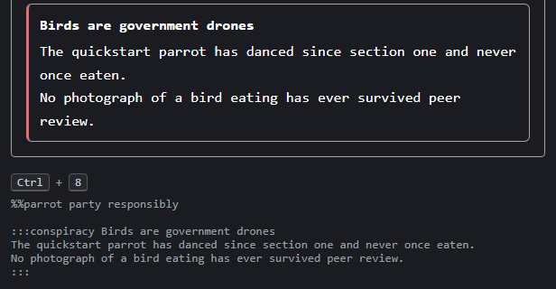

# Walkthrough: a `:::conspiracy` container end to end

Part of the [plugin guide](../plugin-guide.md). It assumes you've built the parrot in [the quickstart](../plugin-guide.md#the-first-fifteen-minutes), since this is the same four moves on a block that holds other blocks.

Enough preamble. This builds a `:::conspiracy` box: an editable container whose first line, `:::conspiracy Birds are government drones`, is a real line you type in (the theory goes after the name), and whose body holds the evidence as ordinary Markdown blocks. One kind answers to two directive names, `:::conspiracy` and `:::debunked` (somebody checked), and reads which one it is off that first line, so the verdict is a rename of the line rather than a second block kind. It runs unchanged in a fresh SvelteKit app.

It reuses the `:::name` directive grammar rather than a hand-written opener. The grammar itself is the [directives guide](../directives.md)'s job; this walkthrough covers the descriptor and the component.

## The registration module

One file declares the kinds, describes them along with the component that draws them, maps the directive names, and returns the whole thing as a `conspiracyPlugin()` unit.

```ts
// conspiracy-kind.ts
import {
	activateDirectives,
	COLON_LINES,
	declarePluginKind,
	declaredPluginKind,
	definePlugin,
	isDirectiveRegistered,
	registerBlockKind,
	registerBlockCommand,
	registerDirective,
	setPluginMetadata,
	withDirectiveName,
	type BlockView,
	type CstNode,
	type EditorPlugin,
	type ParsedDirective
} from '@voithos-labs/aragonite/plugin';
import { conspiracyView } from './conspiracy-view'; // the view built in the next section

const CONSPIRACY = 'conspiracy';

export interface ConspiracyMetadata {
	name: string; // 'conspiracy' or 'debunked', read off the opener line
}

// Build the node from a parsed :::conspiracy fence. The grammar puts the opener line (the
// name and the theory) in front as child 0, so this hands back only the evidence: the
// body's blocks.
function conspiracyFromDirective(parsed: ParsedDirective): CstNode {
	const node: CstNode = {
		kind: declaredPluginKind(CONSPIRACY),
		leadingTrivia: parsed.leadingTrivia,
		raw: parsed.raw,
		innerPrefix: parsed.body?.prefix ?? '',
		children: parsed.body?.children ?? [],
		innerSuffix: parsed.body?.suffix ?? ''
	};
	setPluginMetadata<ConspiracyMetadata>(node, { name: parsed.fence.name });
	return node;
}

function registerConspiracy(view: BlockView): void {
	activateDirectives(); // idempotent; the shared grammar must be live before the first parse

	const conspiracy = declarePluginKind(CONSPIRACY);

	// Two names, one kind: :::conspiracy and :::debunked both resolve here, the kind
	// reading its verdict back from metadata; any other name falls through to the
	// generic directive fallback. The guard is habit: nothing bundled claims these
	// names, but note and tip are claimed by the bundled admonitions plugin, and
	// that is where an unguarded claim throws for real.
	for (const name of [CONSPIRACY, 'debunked']) {
		if (!isDirectiveRegistered('container', name)) {
			registerDirective('container', name, {
				kind: conspiracy,
				fromDirective: conspiracyFromDirective
			});
		}
	}

	// A block command that flips the verdict. The verdict is the name on the opener line, so
	// the command rewrites that line: replaceRaw makes it one undoable edit, and the container
	// is read again under its new name, metadata included.
	const setVerdict = registerBlockCommand(conspiracy, 'conspiracy.setVerdict', (ctx) => {
		if (typeof ctx.arg !== 'string') return false;
		ctx.replaceRaw(withDirectiveName(ctx.node.raw, ctx.arg));
		return true;
	});

	registerBlockKind(conspiracy, {
		view,
		mergeRole: 'container',
		editable: true,
		supportsInline: false,
		// Fences leave no textual way out at either edge, so both take the gap caret. Without
		// this, two adjacent conspiracies give the user nowhere to type a paragraph between them.
		gapEdges: 'both',
		container: {
			// The editor writes the fence lines around the body from this: the opener line as
			// it stands, then a closing line as long as the one it replaces, every colon run
			// widened past a body line that would close it.
			lines: COLON_LINES
			// No title row or Backspace rules to declare: the opener line is child 0 for every
			// `:::` container, Backspace at its start leaves it be, and Backspace at the first
			// body block's start goes to the end of that line.
			// Declare `reorderChildren` here if the body's blocks should reorder among
			// themselves (drag, or Alt+ArrowUp/ArrowDown). Without it, an opaque
			// container like this one declines the move.
		},
		// The Markdown the conformance kits parse: a top-level conspiracy with a title and a body.
		samples: [':::conspiracy Birds are drones\nthey never land near me\n:::\n'],
		keymap: [
			{ chord: 'Mod+7', command: setVerdict, arg: 'conspiracy' }, // allege
			{ chord: 'Mod+8', command: setVerdict, arg: 'debunked' } // debunk
		]
	});
}

export function conspiracyPlugin(): EditorPlugin {
	return definePlugin({
		name: 'conspiracy',
		setup: () => registerConspiracy(conspiracyView)
	});
}
```

`registerDirective`'s `(tier, name)` mapping, the `ParsedDirective` shape, and the per-tier factory rules live in the [directives guide](../directives.md). This module supplies the container factory (`fromDirective`, required for the container tier) and the descriptor. Here's what `conspiracyFromDirective` actually receives for the seed document [Wire it into a page](#wire-it-into-a-page) uses, and what it hands back:

```ts
// parsed, for ':::conspiracy Birds are government drones\nThe quickstart parrot has danced since section one and never once eaten.\n:::\n'
{
	fence: { tier: 'container', colonCount: 3, name: 'conspiracy', info: ' Birds are government drones' },
	body: {
		kind: 'document',
		prefix: '',
		children: [{ kind: 'paragraph', leadingTrivia: '', raw: 'The quickstart parrot has danced since section one and never once eaten.\n' }],
		suffix: ''
	},
	leadingTrivia: '',
	raw: ':::conspiracy Birds are government drones\nThe quickstart parrot has danced since section one and never once eaten.\n:::\n',
	lineEnding: '\n'
}

// the node it builds holds the evidence only
conspiracyFromDirective(parsed).children.map((child) => child.kind); // ['paragraph']

// and the node in the document, once the grammar puts the opener line in front
node.children.map((child) => child.kind); // ['directiveOpenerLine', 'paragraph']
node.children[0].raw; // ':::conspiracy Birds are government drones\n'
getPluginMetadata<ConspiracyMetadata>(node); // { name: 'conspiracy' }
```

Child 0 is the whole opener line, `:::conspiracy` included, kind `directiveOpenerLine`. Every `:::` container gets one, built by the grammar, which is why the factory doesn't. It's a line you type in like any other, with a few manners: a selection that runs onto it from the blocks around clears only the theory, nothing merges into it, and a paste with the caret on the name lands in the theory. So the box doesn't lose its name by accident. Renaming it on purpose (the verdict command, or someone typing over the name) reads the container again under the new name. If your view wants just the theory, `rowContentRange` says where it sits on the line:

```ts
const { start, end } = rowContentRange(node);
node.children[0].raw.slice(start, end); // 'Birds are government drones'
```

## The component

Your view supplies only its own chrome: the border, the opener line's styling, an icon if you like. Chrome may read the node it dresses: the verdict comes off the metadata through `getPluginMetadata`, and the stamp follows it. The editor handles everything else, the child list and its windowing (the editor only mounts the blocks in view) included, once you tell it where the children go with `ctx.container.mountChildren`.

```ts
// conspiracy-view.ts
import { defineBlockView, getPluginMetadata, type BlockViewState } from '@voithos-labs/aragonite/plugin';
import type { ConspiracyMetadata } from './conspiracy-kind';
import './conspiracy.css';

export const conspiracyView = defineBlockView({
	surface: 'container',
	mount(target, ctx) {
		target.classList.add('conspiracy-block');
		ctx.container.mountChildren(target);
		// The verdict is read off the node, so the stamp lands the moment the command commits.
		const draw = ({ node }: BlockViewState) => {
			const verdict = getPluginMetadata<ConspiracyMetadata>(node)?.name;
			target.classList.toggle('debunked', verdict === 'debunked');
		};
		draw(ctx.state());
		return { update: draw };
	}
});
```

```css
/* conspiracy.css */
.conspiracy-block {
	/* the corkboard, with one piece of red string */
	position: relative;
	border: 1px solid var(--color-ui-muted);
	border-left: 3px solid var(--color-error);
	border-radius: 6px;
	padding: 8px 12px;
}
/* the opener line; the `>` steps keep a conspiracy nested inside this one out of it */
.conspiracy-block > .block-list > [data-block-kind='directiveOpenerLine'] .directive-opener-line {
	font-weight: 600;
}
/* debunked: the string comes down, the theory gets crossed out, the stamp lands */
.conspiracy-block.debunked {
	border-left-color: var(--color-ui-muted);
}
.conspiracy-block.debunked
	> .block-list
	> [data-block-kind='directiveOpenerLine']
	.directive-opener-line {
	text-decoration: line-through;
}
.conspiracy-block.debunked::after {
	content: 'DEBUNKED';
	position: absolute;
	top: 6px;
	right: 12px;
	transform: rotate(-12deg);
	font: 600 0.75em monospace;
	letter-spacing: 0.12em;
	color: var(--color-error);
	border: 2px solid currentColor;
	border-radius: 3px;
	padding: 1px 6px;
}
```

`update` runs whenever the block's bytes change, and for a container that's every keystroke in a child, so keep it as cheap as this one. Mind what it returns, too: `false` tells the editor to throw the view away and mount a fresh one, which is why `draw` has a body instead of returning `toggle`'s answer.

Two rules for that view, each earned the hard way:

- **`target` is the block.** The editor measures the element it hands you for the selection highlight and the drag handle, so put your classes on it and fill it, rather than wrapping a second box inside (and never `display: contents`, which measures as nothing).
- **Chrome CSS reads the editor's theme tokens**, plain (`var(--color-ui-muted)`). Inside the editor every one of them has a value, the host's own or the built-in palette's for the current `theme`, so a read needs no fallback. The stable token set by role is the [consumer guide's theme-token manifest](../consumer-guide.md#theme-tokens).

The children mount after anything you've already put in the box you hand `mountChildren` (`target` here, or an element inside it). React or Vue? [React and Vue blocks](react-and-vue.md#a-block-that-holds-blocks) draws a container with your own component.

### Already in Svelte?

The same box as a component, on `createContainerBlock` from `@voithos-labs/aragonite/svelte`. Pass `node`, `index`, and `path` as **thunks**, meaning `getNode` / `getIndex` / `getPath` functions the factory calls to read the live value each time; a captured value would be a stale snapshot, and the type won't accept one.

```svelte
<!-- ConspiracyBlock.svelte -->
<script lang="ts">
	import { getPluginMetadata, type NodeView } from '@voithos-labs/aragonite/plugin';
	import { BlockList, createContainerBlock } from '@voithos-labs/aragonite/svelte';
	import type { ConspiracyMetadata } from './conspiracy-kind';

	let { node, index, myPath = [] }: { node: NodeView; index: number; myPath?: number[] } = $props();
	let boxEl: HTMLElement | undefined = $state();

	const { blockListProps, containerApi, handleKeydown } = createContainerBlock({
		getNode: () => node,
		getIndex: () => index,
		getPath: () => myPath,
		getBoxEl: () => boxEl
	});

	// The verdict is read off the node, so the stamp lands the moment the command commits.
	const debunked = $derived(getPluginMetadata<ConspiracyMetadata>(node)?.name === 'debunked');

	export { containerApi };
</script>

<!-- svelte-ignore a11y_no_static_element_interactions -->
<div class="conspiracy-block" class:debunked bind:this={boxEl} onkeydown={handleKeydown}>
	<BlockList {...blockListProps} />
</div>

<style>
	.conspiracy-block {
		/* the corkboard, with one piece of red string */
		position: relative;
		border: 1px solid var(--color-ui-muted);
		border-left: 3px solid var(--color-error);
		border-radius: 6px;
		padding: 8px 12px;
	}
	/* the opener line; the `>` steps keep a conspiracy nested inside this one out of it */
	.conspiracy-block
		> :global(.block-list > [data-block-kind='directiveOpenerLine'] .directive-opener-line) {
		font-weight: 600;
	}
	/* debunked: the string comes down, the theory gets crossed out, the stamp lands */
	.debunked {
		border-left-color: var(--color-ui-muted);
	}
	.debunked
		> :global(.block-list > [data-block-kind='directiveOpenerLine'] .directive-opener-line) {
		text-decoration: line-through;
	}
	.debunked::after {
		content: 'DEBUNKED';
		position: absolute;
		top: 6px;
		right: 12px;
		transform: rotate(-12deg);
		font: 600 0.75em monospace;
		letter-spacing: 0.12em;
		color: var(--color-error);
		border: 2px solid currentColor;
		border-radius: 3px;
		padding: 1px 6px;
	}
</style>
```

Register it with `svelteBlockView(ConspiracyBlock)` in place of `conspiracyView`, and keep two more rules:

- **`export { containerApi }` is the whole publication.** It's how the editor talks to your container (a caret walking in descends through it, for one), and the name is fixed. Leave it out and your typecheck (svelte-check, or `tsc` on a plain-TypeScript plugin) fails at the call that makes the view (`svelteBlockView` here). The factory's `containerApi` is always complete; a hand-rolled one can annotate itself `satisfies ContainerBlockComponent` to get a missing member reported at the definition instead.
- **`BlockList` stays a _direct_ child of your box**, so the container's windowing finds it. Other chrome (an icon, a toggle button) may sit beside it. Your keymap's chords work from that chrome too, a button or a field in it included.

A container's `ctx` carries more than the conspiracy uses. The Svelte factory returns the same things under its own names (`updateOwnMetadata`, `getPresentationMode()`, `getTheme()`, `getOptions()`, `getEditor()`, and so on):

| Call | When you reach for it |
| --- | --- |
| `ctx.container.updateOwnMetadata` | Your component writes its own node's metadata (a collapse toggle, an edited setting). The supported commit path; in reading mode, which writes no bytes, it declines as a no-op and dev builds warn. If the edit should move the caret (a collapse hiding the child it sat in), pass `{ caret: { path, offset } }` and the commit puts it there once it renders. `path` is child indices from your block (`[]` for the block itself, `[0]` for its first child), and `offset` is a character offset into that child's text, or `CURSOR_END` for its end. Don't focus anything yourself afterwards |
| `ctx.container.moveFocusOut` | A plugin-owned editing surface whose caret ran off its own edge; hands the caret to whatever a plain arrow would have landed on |
| `ctx.state().presentationMode` | Your rendering or a gesture needs the live presentation mode ([Presentation modes](presentation-modes.md#presentation-modes)) |
| `ctx.state().theme` | Your content's colors are painted by an engine rather than styled by CSS; token-styled chrome needs neither this nor the presentation mode, it rethemes through the cascade |
| `ctx.editor.options` | This editor's options for the plugin that owns your kind, your `defaults` included, typed `unknown`. It's how a value differs per editor, which a factory argument can't do ([the options recipe](per-editor.md#recipe-per-instance-options-and-the-factory-closure-trap)) |
| `ctx.editor` | This editor's `EditorContext` for the plugin that owns your kind (the factory's `getEditor()` is undefined in a bare test harness). Its `computeInlineContent` reads the syntax this editor draws. If your helper's reader defaults to the free `computeInlineContent`, pass it this one, and from the factory `getEditor()?.computeInlineContent`, which still parses in a bare harness (the bundled toc and footnotes do exactly this) |
| `ctx.container.captureScrollPosition` | Your component is about to swap its view for one of a different height (a tall diagram for its short source card) and the reader is scrolled right at it. Call it before the swap, await what it hands back after, and the page stays where the reader left it instead of clamping to the shorter layout in between |
| `ctx.container.openDraft` | Your component holds an edit outside the document, like a textarea's text, as a draft of your block's bytes ([What your own editing surface has to do](render-primary.md#what-your-own-editing-surface-has-to-do)) |

```ts
const { container } = ctx;
container.updateOwnMetadata({ open: false }); // one undo entry; the bytes are rewritten after the patch
container.updateOwnMetadata({ open: false }, { caret: { path: [0], offset: 0 } }); // ...and the caret lands on child 0's start
ctx.state().presentationMode; // 'source'
ctx.state().theme; // 'dark'
ctx.editor.options; // your defaults with this editor's { plugin, options } entry merged over them
const restore = container.captureScrollPosition(); // before the swap...
showSourceCard();
await restore(); // ...and after; a no-op when nothing moved
```

One more is for a container whose first line starts with a marker the way a list item's `- ` does (a footnote definition's `[^label]: `, say): **`getAmbientPrefix`**, a dep of the Svelte factory, or `ambientPrefix(state, editor)` beside `mount` in a DOM view's spec. Its first child paints that prefix as a dimmed, read-only run before its own bytes, and the caret skips it the way it skips a list marker.

- Return a string, read live, so a marker derived from metadata re-renders after an edit.
- Or return `{ text, interactive }` to make ranges of it clickable. Each range gets its own span, class and click handler (that's how a footnote definition's `[^label]` takes the click back to its reference).
- A range can also carry a role, a `label`, and a tab stop (`focusable`), together with the `onActivate` that Enter and Space run. Decide `focusable` by mode: a tab stop inside an editable block gets in the caret's way, so the footnote marker only takes one in reading mode.

## Wire it into a page

Pass the plugin to the editor's `plugins` prop. It installs before the seed parses, so `:::conspiracy` resolves to your kind:

```svelte
<script module lang="ts">
	import { conspiracyPlugin } from './conspiracy-kind';

	const plugins = [conspiracyPlugin()];
</script>

<script lang="ts">
	import { Editor } from '@voithos-labs/aragonite/svelte';
	import '@voithos-labs/aragonite/styles/editor-theme.css';

	const SEED =
		':::conspiracy Birds are government drones\nThe quickstart parrot has danced since section one and never once eaten.\n:::\n';
	let editor = $state();
</script>

<div class="aragonite-editor-theme" data-editor-theme="light">
	<Editor bind:this={editor} source={SEED} {plugins} theme="light" />
</div>
```

The chords are live (a **chord** is a key combination, written `Mod+7` where `Mod` is Ctrl, or Cmd on a Mac). Focus the box, press `Mod+8` to debunk the theory (the string comes down and the stamp lands) and `Mod+7` to allege it again, then read `editor.getSource()` back and watch the opener line flip between the two names:

```ts
editor.getSource();
// ':::conspiracy Birds are government drones\nThe quickstart parrot has danced since section one and never once eaten.\n:::\n'
// ...press Mod+8...
editor.getSource();
// ':::debunked Birds are government drones\nThe quickstart parrot has danced since section one and never once eaten.\n:::\n'
```

The flip is one undoable edit, so undo un-debunks it, which is how conspiracies work anyway. And because the verdict lives in the bytes, a debunked conspiracy stays debunked across a reload.

The wrapper and the two `light`s are there because the editor paints no background of its own. A fresh app's page is white, so the built-in chrome (the wrapper's attribute) and the editor's own surfaces (the prop) both have to say so; on a dark page, both say `dark`, or nothing. [consumer-guide.md](../consumer-guide.md)'s theming section explains the two tiers.

Want a collapse toggle? Declare the title row (`reservedChrome`) with an `isCollapsed` probe over the node, and every focus walk, merge, and windowing decision (a collapsed body stays unmounted) reads that one declaration. Add `expandPatch` beside it, returning the metadata patch that opens the node, and a reveal into the collapsed body (a table-of-contents entry, a search match) opens the container first and commits it as one undoable edit. Without it, such a reveal has nowhere to land and reports that it didn't. A `:::` box folds the same way, except its title row is the opener line the grammar builds, so the `reservedChrome` you add names that row: `{ kind: DIRECTIVE_OPENER_LINE, isCollapsed }`, with `DIRECTIVE_OPENER_LINE` from `/plugin`. A dev build warns if it names any other.


