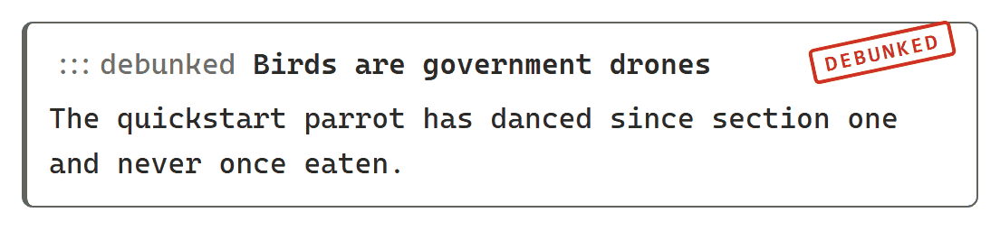

# Walkthrough: a `:::conspiracy` container end to end

Part of the [plugin guide](../plugin-guide.md). It assumes you've built the parrot in [the quickstart](../plugin-guide.md#the-first-fifteen-minutes), since this is the same two calls on a block that holds other blocks.

Enough preamble. This builds a `:::conspiracy` box: an editable container whose first line, `:::conspiracy Birds are government drones`, is a real line you type in (the theory goes after the name), and whose body holds the evidence as ordinary Markdown blocks. One block type answers to two names, `:::conspiracy` and `:::debunked` (somebody checked), and reads which one it is off that first line, so the verdict is a rename of the line rather than a second block type. It's plain DOM, so it runs in any app.

It reuses the `:::name` directive grammar rather than a reader of its own. The grammar itself is the [directives guide](../directives.md)'s job; this walkthrough covers the block type and its drawing.

## The plugin

One file makes the block type and the plugin that lists it:

```ts
// conspiracy-plugin.ts
import {
	colonLines,
	command,
	container,
	definePlugin,
	type Block
} from '@voithos-labs/aragonite/plugin';
import './conspiracy.css';

/** The verdict is the name on the opening line: `conspiracy` or `debunked`. */
interface Verdict {
	name: string;
}

// A chord rewrites the name on the opening line, as one undo step.
const verdict = (id: string, title: string, name: string) =>
	command<Block<Verdict>>({
		id,
		title,
		run(editor, block) {
			void editor.edit().data(block, { name }).commit();
		}
	});

const conspiracy = container<Verdict>({
	name: 'conspiracy',
	label: 'Conspiracy',
	// Two names, one block type. The theory after the name is the box's title row.
	lines: colonLines({
		names: ['conspiracy', 'debunked'],
		title: { label: 'Theory', className: 'conspiracy-theory' }
	}),
	chords: {
		'Mod+7': verdict('allege', 'Allege', 'conspiracy'),
		'Mod+8': verdict('debunk', 'Debunk', 'debunked')
	},
	sample: ':::conspiracy Birds are drones\nthey never land near me\n:::\n',
	insert: { label: 'Conspiracy', icon: 'info', insert: ':::conspiracy\n\n:::\n' },
	draw(block, ctx) {
		const dom = document.createElement('div');
		dom.className = 'conspiracy-block';
		dom.append(ctx.children);
		// The stamp follows the verdict, so it lands the moment a chord commits.
		const stamp = (now: Block<Verdict>) => {
			dom.classList.toggle('debunked', now.data.name === 'debunked');
		};
		stamp(block);
		return { dom, update: stamp };
	}
});

export const conspiracyPlugin = definePlugin({
	name: 'conspiracy',
	version: '1.0.0',
	editor: '^0.11.5',
	contributes: () => ({ blocks: [conspiracy] })
});
```

What each part does:

- **`colonLines({ names })`** is the `:::` shape. The editor reads the opening line, the closing `:::` and the body between them, and writes all three back on every edit, a colon run growing past a body line that would close the box. Listing the plugin also turns on the rest of the `:::` grammar: boxes no plugin claims, `::leaf` lines and `:text[]`.
- **The data is `{ name }`**, read off the opening line. Whatever follows the name is the box's title row, and `title` gives that row a screen-reader label and a class.
- **The chords** write the verdict with `edit().data(block, { name })`: the name alone, as one undo step, and the box is read again under its new name. A name the block type doesn't hold is refused.
- **`draw`** builds the box and places `ctx.children`, where the editor has already mounted the body's blocks. It hands back `update`, which runs whenever the block's bytes change.

Here's how the editor reads the seed [Wire it into a page](#wire-it-into-a-page) uses:

```ts
import { grammar } from '@voithos-labs/aragonite/plugin';

const [box] = grammar([conspiracyPlugin]).parse(
	':::conspiracy Birds are government drones\nThe quickstart parrot has danced since section one and never once eaten.\n:::\n'
).blocks;
box.type.name; // 'conspiracy/conspiracy'
box.data; // { name: 'conspiracy' }
box.title?.text; // 'Birds are government drones'
box.children.map((child) => child.type.name); // ['paragraph']
```

The title row is a line you type in like any other, with a few manners: a selection that runs onto it from the blocks around clears only the theory, nothing merges into it, and a paste with the caret on the name lands in the theory. So the box doesn't lose its name by accident. Losing it on purpose works too: select the colons (or `:::conspiracy ` whole) and delete, and the box unwraps, its closing line gone and the theory and the body left as plain blocks. Renaming it on purpose (a chord, or someone typing over the name) reads the box again under the new name.

## The drawing

Your drawing supplies only its own chrome: the border, the title's styling, a stamp. The editor handles everything else, the child list and its windowing (it only mounts the blocks in view) included.

```css
/* conspiracy.css */
.conspiracy-block {
	/* the corkboard, with one piece of red string */
	position: relative;
	border: 1px solid var(--color-ui-muted);
	border-left: 3px solid var(--color-error);
	border-radius: 6px;
	padding: 8px 12px;
}
/* the theory: the title row carries the class `title` names */
.conspiracy-theory {
	font-weight: 600;
}
/* debunked: the string comes down and the stamp lands */
.conspiracy-block.debunked {
	border-left-color: var(--color-ui-muted);
}
.conspiracy-block.debunked::after {
	content: 'DEBUNKED';
	position: absolute;
	top: 6px;
	right: 12px;
	transform: rotate(-12deg);
	font: 600 0.75em monospace;
	letter-spacing: 0.12em;
	color: var(--color-error);
	border: 2px solid currentColor;
	border-radius: 3px;
	padding: 1px 6px;
}
```

`update` runs on every keystroke in a child, since each one changes the box's bytes, so keep it as cheap as this one. Mind what it returns, too: `false` tells the editor to throw the drawing away and draw it again, which is why `stamp` has a body instead of returning `toggle`'s answer.

Two rules for a drawing, each earned the hard way:

- **`dom` is the block.** The editor measures the element you hand back for the selection highlight and the drag handle, so put your classes on it and fill it, rather than wrapping a second box inside (and never `display: contents`, which measures as nothing).
- **Chrome CSS reads the editor's theme tokens**, plain (`var(--color-ui-muted)`). Inside the editor every one of them has a value, the host's own or the built-in palette's for the current `theme`, so a read needs no fallback. The stable token set by role is the [consumer guide's theme-token manifest](../consumer-guide.md#theme-tokens).

A container's `ctx` carries more than the conspiracy uses:

| Field | When you reach for it |
| --- | --- |
| `ctx.title` | The title row's own element, to point `aria-labelledby` at or place a control beside. It stays among the children, so never move it |
| `ctx.mode`, `ctx.theme` | Your drawing changes with the presentation mode ([Presentation modes](presentation-modes.md#presentation-modes)), or paints colors with an engine rather than CSS |
| `ctx.editor` | This editor: its document, its selection, `edit()` for a write of your own |
| `ctx.keepScroll()` | Your drawing is about to change height on its own (an expander's click); await what it hands back once it has, and the page stays where the reader left it |

Already in Svelte, React or Vue? `svelteBlock(Component)` from `/svelte`, `reactBlock` and `vueBlock` make the same `draw` from your component, which places the children with `<Slot of="children" />` ([React and Vue blocks](react-and-vue.md#a-block-that-holds-blocks)).

## Wire it into a page

Pass the plugin to the editor's `plugins` prop. The editor reads its document with it, so `:::conspiracy` is your box from the first paint:

```svelte
<script module lang="ts">
	import { conspiracyPlugin } from './conspiracy-plugin';

	const plugins = [conspiracyPlugin];
</script>

<script lang="ts">
	import { Editor } from '@voithos-labs/aragonite/svelte';
	import '@voithos-labs/aragonite/styles/editor-theme.css';

	const SEED =
		':::conspiracy Birds are government drones\nThe quickstart parrot has danced since section one and never once eaten.\n:::\n';
	let editor = $state();
</script>

<div class="aragonite-editor-theme" data-editor-theme="light">
	<Editor bind:this={editor} source={SEED} {plugins} theme="light" />
</div>
```

The chords are live (a **chord** is a key combination, written `Mod+7` where `Mod` is Ctrl, or Cmd on a Mac). Click into the evidence, press `Mod+8` to debunk the theory (the string comes down and the stamp lands) and `Mod+7` to allege it again, then read `editor.getSource()` back and watch the opening line flip between the two names:

```ts
editor.getSource();
// ':::conspiracy Birds are government drones\nThe quickstart parrot has danced since section one and never once eaten.\n:::\n'
// ...press Mod+8...
editor.getSource();
// ':::debunked Birds are government drones\nThe quickstart parrot has danced since section one and never once eaten.\n:::\n'
```

The flip is one undoable edit, so undo un-debunks it, which is how conspiracies work anyway. And because the verdict lives in the bytes, a debunked conspiracy stays debunked across a reload.

The wrapper and the two `light`s are there because the editor paints no background of its own. A fresh app's page is white, so the built-in chrome (the wrapper's attribute) and the editor's own surfaces (the prop) both have to say so; on a dark page, both say `dark`, or nothing. [consumer-guide.md](../consumer-guide.md)'s theming section explains the two tiers.

Want a collapse toggle? A box on fenced lines folds under its title with `closable` (`fencedLines`, with a title line); a `:::` box can't fold yet.


