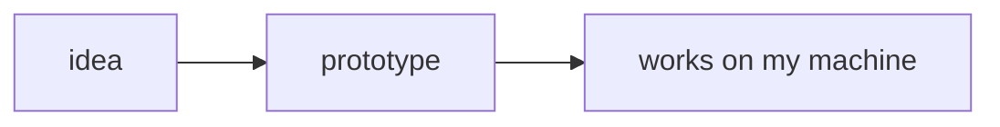

# @voithos-labs/aragonite-mermaid

Mermaid diagrams plugin for [aragonite](https://github.com/voithos-labs/aragonite).

## What it reads

Any code fence whose language is `mermaid`:

````markdown

````

## Install

```bash
npm install @voithos-labs/aragonite @voithos-labs/aragonite-mermaid mermaid
```

Btw, the plugin's version should match the editor's version.

## Use it

```ts
import { mermaidPlugin } from '@voithos-labs/aragonite-mermaid';
import { mermaidRenderer } from '@voithos-labs/aragonite-mermaid/renderer';

const plugins = [mermaidPlugin({ renderer: mermaidRenderer })];
```

Hand `plugins` to the editor, and build the array once for the whole app, not once per editor. A few things worth knowing:

- On React, Vue or plain JS, the diagrams bring a stylesheet of their own: import `@voithos-labs/aragonite-mermaid/style.css` beside the editor's.
- Double-click a diagram (or click Edit) to open its source. `Ctrl+Enter` (`Cmd+Enter` on a Mac) or clicking away saves it, and `Escape` drops the change.
- With the diagram focused, drag to pan and Ctrl+scroll (Cmd+scroll on a Mac) to zoom, and Reset puts it back. `Ctrl+M` (`Cmd+M` on a Mac) or the Focus button opens a bigger view where plain scrolling zooms; `Escape` closes it.
- Diagrams use the mermaid theme named like the editor's `theme` (`dark`, `forest`, `neutral`), or mermaid's default when there isn't one.
- Rather draw with something else? `renderer` is any function from `(code, id, { theme })` to a promise of SVG markup.

## More

The [consumer guide](https://github.com/voithos-labs/aragonite/blob/main/docs/guide/consumer-guide.md#bundled-plugins) lists the first party plugins, and the plugin guide's [page on picture-like blocks](https://github.com/voithos-labs/aragonite/blob/main/docs/guide/plugin-guide/render-primary.md) uses this one as its worked example.

## License

Aragonite and its first party plugins are free software, released under [MPL-2.0](./LICENSE): use it, study it, fork it, embed it in whatever you're building, closed source included. The one string attached: if you change the lib/plugin's files, you share those changes under the same license.
