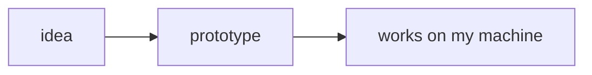

# @voithos-labs/aragonite-mermaid

Mermaid diagrams for [aragonite](https://github.com/voithos-labs/aragonite). A ` ```mermaid ` code fence draws as the diagram it describes, and an Edit button opens the source when you want to change it. What's aragonite? The [readme](https://github.com/voithos-labs/aragonite/blob/main/README.md) answers that at length, and [aragonite.dev](https://aragonite.dev) answers it by example.

## What it reads

````markdown

````

Any code fence whose language is `mermaid` counts, backticks or tildes. It's an ordinary fence in the file. Without the plugin the same lines are a code block, and GitHub draws them as a diagram too.

## Install

```bash
npm install @voithos-labs/aragonite @voithos-labs/aragonite-mermaid mermaid
```

The plugin moves in lockstep with the editor and asks for its exact version, so bump them together. `mermaid` (11.16 and up, or 12) is optional and only there for the renderer below; leave out both and each diagram just shows its source.

## Use it

```ts
import { mermaidPlugin } from '@voithos-labs/aragonite-mermaid';
import { mermaidRenderer } from '@voithos-labs/aragonite-mermaid/renderer';

const plugins = [mermaidPlugin({ renderer: mermaidRenderer })];
```

Pass `plugins` to the editor, building the array once for the whole app. The renderer only loads mermaid when the first diagram draws, so mermaid stays out of your main bundle. Once it's running:

- React, Vue or no framework at all? The diagram's styles are in `@voithos-labs/aragonite-mermaid/style.css`; import it with the editor's `style.css`.
- Double-click a diagram (or click Edit) to open its source. `Ctrl+Enter` (`Cmd+Enter` on a Mac) or clicking away saves it as one undo step, and `Escape` drops the change. An empty diagram opens straight into its source.
- With the diagram focused, drag to pan and Ctrl+scroll (Cmd on a Mac) to zoom, and Reset puts it back. `Ctrl+M` or the Focus button opens a bigger view where plain scrolling zooms; `Escape` closes it.
- A diagram mermaid can't parse shows mermaid's error message where the picture would be.
- It draws for the editor's theme: `dark` gets mermaid's dark theme, a theme named after one of mermaid's (`forest`, `neutral`) gets that one, and anything else gets mermaid's default.
- Rather draw with something else? `renderer` is any function from `(code, id, { theme })` to a promise of SVG markup.

## More

The [consumer guide](https://github.com/voithos-labs/aragonite/blob/main/docs/guide/consumer-guide.md#bundled-plugins) covers the rest of the bundled plugins, and the plugin guide's [page on picture-like blocks](https://github.com/voithos-labs/aragonite/blob/main/docs/guide/plugin-guide/render-primary.md) uses this one as its worked example.

## License

Free software, released under [MPL-2.0](./LICENSE) like the editor itself: use it, study it, fork it, embed it in whatever you're building, closed source included. The one string attached: if you change this plugin's own files, you share those changes under the same license.
